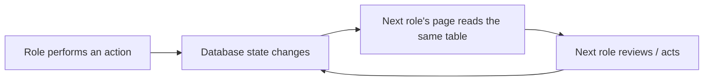
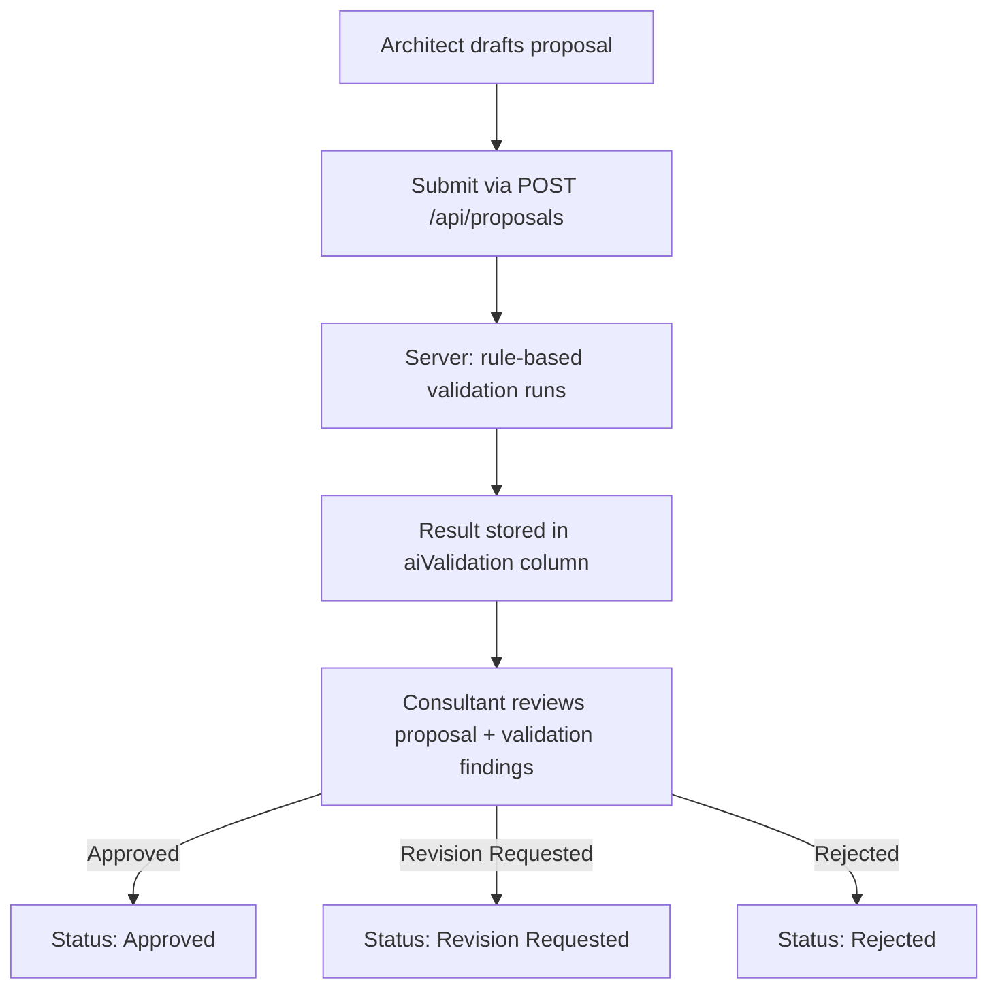
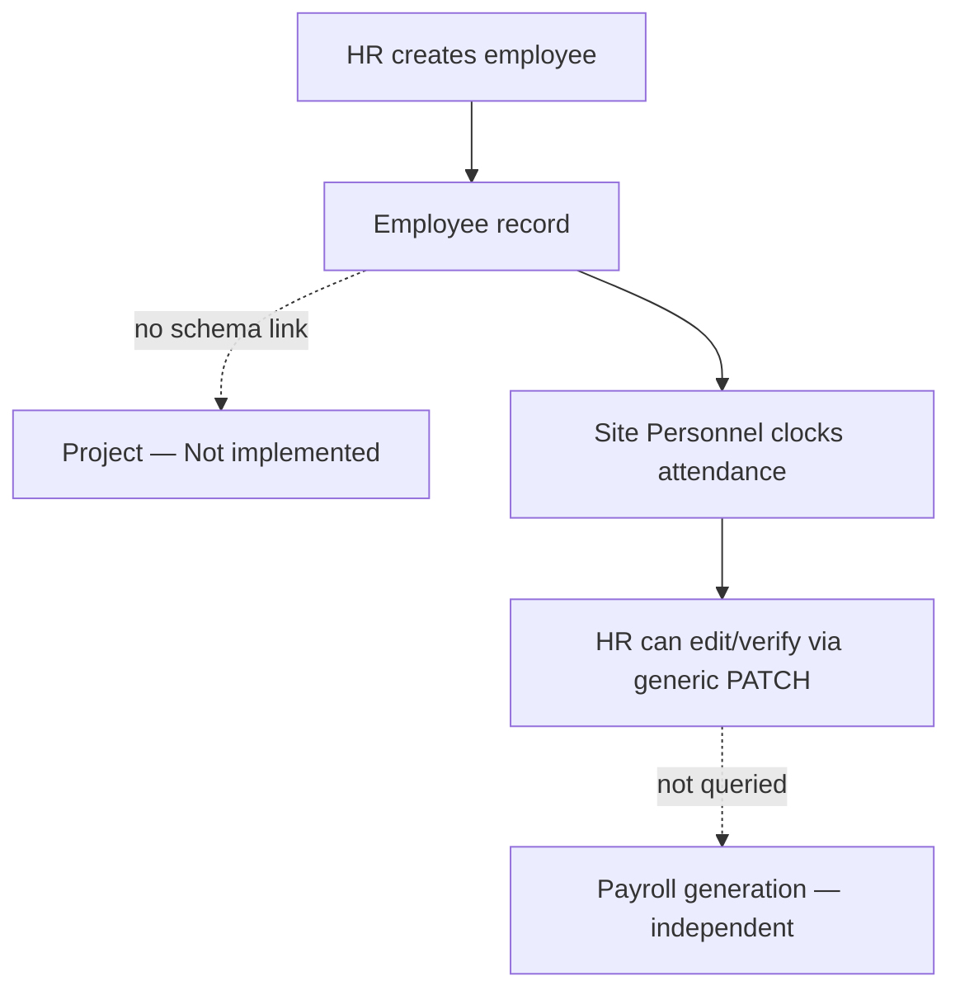
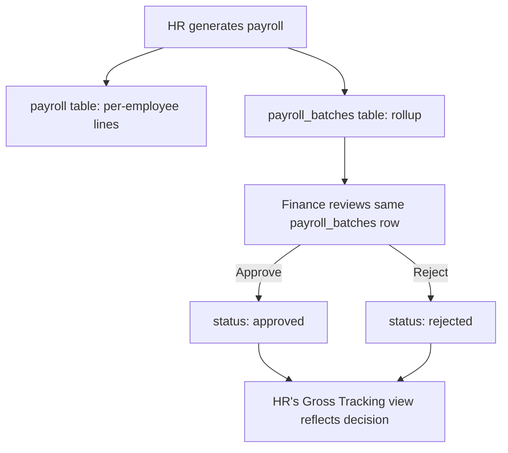
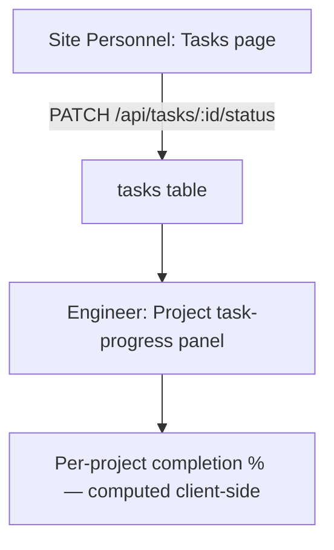
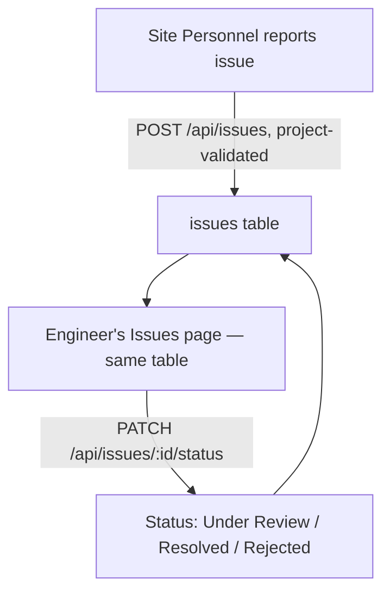

# EasyConstruct — Role Interactions & Workflow Reference

This document describes **what is actually implemented** in EasyConstruct's cross-role workflows as of this refactor pass ("Phase 1"), not what was originally planned. Every workflow below is labeled by how connected it really is, based on reading the actual repository/service/controller code — not assumed from page or button names. Anything not implemented is labeled **Not implemented** explicitly, per the project's own anti-overclaiming rule.

## 1. System-wide workflow overview

EasyConstruct is a construction operations platform with 8 roles collaborating around a shared Postgres database (via Drizzle ORM) and an Express REST API. The core principle this refactor targeted:

Before this pass, several pages that *looked* connected were actually reading from disjoint tables or mock data. This pass fixed the highest-value disconnects (see §21 "What was refactored").

## 2. Role list

1. Super Admin
2. Admin
3. Human Resources (HR)
4. Finance Manager
5. Architect
6. Engineer
7. Site Personnel
8. Consultant

## 3. Role responsibilities (as implemented)

| Role | Implemented responsibilities |
|---|---|
| Super Admin | Same Admin Workspace as Admin (dashboard, projects, workflows, documents, activity logs, security, notifications, roles view, workflow configuration, approval hierarchy, support). **User/role management (activate/deactivate users, assign roles) is Not implemented** — see §16. |
| Admin | Project oversight (CRUD), workflow initiation/monitoring/approval, document oversight, activity-log monitoring, notifications, read-only roles/workflow-configuration views. |
| HR | Employee CRUD, attendance record management, payroll generation, workforce reporting. |
| Finance Manager | Budget CRUD (now project-validated), payroll batch review (approve/reject), expense/cash-flow/profitability views. |
| Architect | Proposal submission (with real-time rule-based validation), design/blueprint/documentation uploads (siloed — see §16). |
| Engineer | Requirement drafting (now project-validated), technical/site progress reports, **issue review and resolution** (fixed this pass), project task-progress rollup view. |
| Site Personnel | Task status updates (UI added this pass), issue reporting (now project-validated), attendance clock-in/out, field document uploads. |
| Consultant | Proposal review (approve/reject/request revision), viewing rule-based validation findings, advisory document uploads. |

## 4. Cross-role interaction matrix (actual, not aspirational)

| From → To | Interaction | Status |
|---|---|---|
| Architect → Consultant | Proposal submitted, reviewed on the same DB row | **Connected** |
| Architect → Engineer | Proposal technical input | **Not implemented** — no Engineer code path touches `proposals` |
| Site Personnel → Engineer | Issue reported, reviewed/resolved on the same DB row | **Connected** (fixed this pass — previously Engineer read a different table) |
| Site Personnel → Engineer/Admin | Task status → task-progress rollup panel | **Connected** (UI added this pass; read-only rollup, doesn't mutate `projects.progress`) |
| HR → Finance | Payroll batch generated, reviewed on the same `payroll_batches` row | **Connected** (was already working) |
| HR → Admin | Workforce reports | **Partially connected** — real aggregation exists (`workforce-reports`), but not surfaced on the Admin dashboard as a workforce panel (documented limitation, see Admin dashboard's "Workforce snapshot" placeholder) |
| Finance → Architect/Engineer | Budget/change impact information | **Not implemented** — Impact Awareness doesn't exist |
| Admin → all roles | Project/workflow/document coordination via the generic workflow-approval engine | **Connected** |
| Super Admin → all roles | Account/access management | **Not implemented** — no user management UI/API exists |
| AI → any role | Decision support | **Rule-based, not AI** — see §13 |

## 5. Proposal workflow

- **Submission**: `POST /api/proposals` (`server/src/proposals/*`) — real insert, project picker prevents an unmatched `projectCode` from being typed at the UI layer (server does not yet hard-reject an unmatched code on this endpoint the way it does for issues/requirements/budgets — see §16).
- **Validation**: `server/src/proposals/validation.ts`, run synchronously in `service.create`. Real, deterministic checks: title presence/length, project-code match, description presence, amount format. Result is JSON `{ passed, issues[], warnings[], checkedAt }` stored in the existing `aiValidation` column — **no external AI API is used or configured anywhere in this codebase.**
- **Review**: `PATCH /api/proposals/:id/review` — Consultant sets `status`/`reviewerName`/`reviewComment` on the same row the Architect created.
- **Approved proposal → project creation**: **Not implemented.** There is no code path that converts an approved proposal into a `projects` row.
- **Engineer contribution to proposals**: **Not implemented.**

## 6. Project creation / project oversight workflow

Admin/PM can create, update, and delete projects directly (`server/src/projects/*`, unrelated to the proposal flow above). This was already working and unchanged in Phase 1.

## 7. Workforce workflow

- **Employee ↔ project assignment**: **Not implemented** — `employees` has no project field at all.
- **Attendance ↔ employee**: soft varchar match (`attendance.employeeId` ~ `employees.employeeId`), no FK.
- **Attendance → payroll**: **Not implemented** — `payroll/service.ts generate()` computes gross pay entirely from manually entered `hoursWorked`/`overtimeHours`, never reads the `attendance` table.

## 8. Attendance workflow

Site Personnel clock in/out (`server/src/attendance/*`). HR can edit any record via the generic `PATCH /api/attendance/:id` (role-gated to `project-manager, human-resources, admin, super-admin`) — there's no dedicated "verify" action distinct from a general edit, but the capability exists and is now audit-logged (see §19).

## 9. Payroll workflow

This was already genuinely connected before this pass (`server/src/payroll/service.ts` and `server/src/finance/payroll-review/*` share the same `payroll_batches` table). Phase 1 added audit-log entries for `generate` and `decide` actions.

## 10. Project execution workflow (tasks)

- **Before this pass**: the tasks backend (`server/src/tasks/*`) was solid — real `Pending → In Progress → Completed` state machine, ownership checks — but the Site Personnel Tasks page was a bare placeholder, so nothing ever wrote to it.
- **Fixed this pass**: `client/src/pages/roles/site-personnel/sp-tasks.tsx` now uses the existing `useMyTasks` hook to list and advance real tasks. `client/src/pages/roles/engineer/engineer-progress.tsx` gained a "Project task progress" panel computed client-side from `GET /api/tasks`, grouped by `projectCode`.
- This rollup is **read-only** — it does not write back to the static `projects.progress` column, so it can't destabilize existing project data. `projects.progress` itself remains a manually-set value, not auto-computed.
- Also fixed: `server/src/tasks/controller.ts` compared `req.authUser.role` against `"site_personnel"` (underscore) while every other role check in the codebase uses `"site-personnel"` (hyphen) — the Site-Personnel task-scoping filter never actually applied. Now fixed to the correct hyphenated string.

## 11. Document workflow

- The generic `documents` table (`server/src/documents/*`) is genuinely shared: Admin, PM, and Site Personnel all read/write the same table, filtered by `project`/`type`. **Connected.**
- Architect's `architect_documents` and `blueprints` tables are **separate tables with no project-code field and no other role's page querying them** — they remain siloed to the Architect role. **Not fixed this pass** (out of scope; would require either adding a project link to those schemas or building cross-role read access, both larger changes than Phase 1's budget).

## 12. Issue workflow

**Before this pass**: Site Personnel wrote to the real `issues` table; the Engineer's "Issues" page instead read `engineering_reports` filtered by `type="issues"` — a completely different table populated only by the Engineer's own self-authored reports. An issue Site Personnel reported was invisible to Engineer.

**Fixed this pass**:
- `client/src/pages/roles/engineer/engineer-issues.tsx` rewritten to use `client/src/features/issues/*` (the real table).
- Added a working resolve/status-update action wired to the previously-frontend-orphaned `PATCH /api/issues/:id/status` endpoint.
- Fixed the same `"site_personnel"` vs `"site-personnel"` role-string bug in `server/src/issues/controller.ts` — Site Personnel's "My issues" view is now correctly scoped to their own reports (previously the filter silently never applied and Site Personnel saw everyone's issues too).
- Issue submission now requires an existing project code (server-side guard + `ProjectPicker` on the report form).
- `engineering_reports` remains a separate, legitimate feature for Engineer's self-authored "Progress" reports — untouched.

**AI issue-resolution suggestions**: **Not implemented** — no such feature exists anywhere (not even a placeholder).

## 13. AI decision-support workflow (rule-based, not external AI)

No OpenAI/Anthropic/Gemini key or SDK exists anywhere in this repository. Per an explicit scope decision this pass, "AI" surfaces are implemented as **real, deterministic rule-based logic**, honestly labeled as such in the UI (never "AI-approved"):

| Surface | Status |
|---|---|
| Proposal validation (`aiValidation` column) | **Implemented, rule-based** — `server/src/proposals/validation.ts`. Checks title/description/amount presence and project-code match. Shown to Architect and Consultant labeled "Rule-based validation — human review required." |
| Workflow `aiNote` | **Not implemented** — always `null`; only non-null values in the whole repo are hardcoded demo strings in `client/src/providers/mock-data.ts`, unrelated to real workflows. |
| Finance AI insights | **Not implemented** — routes are commented out server-side (`server/src/routes/finance.ts`); the frontend page falls back to an empty state. |
| Engineer "AI-assisted requirement drafting" | **Not implemented** — the requirement dialog is a plain manual form. |
| Issue "AI-suggested resolution" | **Not implemented**. |
| Impact Awareness | **Not implemented** — see §14. |

No AI output anywhere in this codebase can finalize an approval, rejection, or financial/professional decision — every reviewer-facing surface requires an explicit human action (Approve/Reject/Return, or a manual status change).

## 14. Impact Awareness workflow

**Not implemented.** `client/src/pages/roles/finance/finance-impact-review.tsx` and `client/src/pages/roles/shared/shared-ai-insights.tsx` are both bare `ComingSoonCard` placeholders. No backend module computes cost/timeline/resource/risk impact for a proposed change. This is a genuinely net-new feature (a real analysis engine + a "proposed change" data model), out of scope for this pass.

## 15. Reporting workflow

- **Workforce reports** (`server/src/workforce-reports/*`): real aggregation from `employees`, `attendance`, `payroll` — **connected**, consumed by `hr-workforce.tsx`.
- **Generic "Reports" page** (`client/src/pages/roles/shared/shared-reports.tsx`): still a placeholder — **not implemented**. No task/project/issue data feeds any generic report endpoint.

## 16. Permission boundaries

RBAC is enforced via `authenticate` + `requireRole(...)` middleware (`server/src/middleware/auth.ts`), checked on every route mounted behind it. Notable boundaries as implemented:

- Only `project-manager`, `engineer` can move an issue to `Resolved`/`Rejected`; only `site-personnel`/`engineer` can create one.
- Only `site-personnel` can advance their own task's status; ownership is checked server-side (`assignedToUserId !== actingUserId` → 403).
- Only `finance-manager`/`finance_manager` can decide a payroll batch.
- `admin`/`super-admin` are treated identically everywhere (`PRIVILEGED_ROLES` bypass in `workflows/service.ts`) — there is no code-level distinction between them today; both get the same Admin Workspace. **Super Admin-specific capabilities (user management, role assignment) are Not implemented.**
- Budget, requirement, and issue creation now server-side reject a `projectCode`/`project` that doesn't match an existing `projects.code` row (added this pass) — proposal creation does not yet have the equivalent hard rejection (client-side picker only).

## 17. Database entities involved

`users`, `employees`, `attendance`, `payroll`, `payroll_batches`, `projects`, `proposals`, `workflows`/`workflow_stages`/`workflow_templates`, `tasks`, `issues`, `requirements`, `documents`, `architect_documents`, `blueprints`, `budgets`, `audit_logs`, `roles`, `notifications`, `engineering_reports`. No new tables were added this pass — every fix reused existing schema.

## 18. Important API endpoints touched this pass

| Endpoint | Change |
|---|---|
| `POST /api/proposals` | Now runs rule-based validation and stores the result |
| `GET/PATCH /api/issues*` | Fixed role-scoping bug; now project-validated on create; frontend now actually calls the status-update endpoint |
| `GET/PATCH /api/tasks*` | Fixed role-scoping bug; frontend now actually calls it (previously orphaned) |
| `POST /api/requirements` | Now project-validated |
| `POST /api/finance/budgets` | Now project-validated |
| `GET /api/audit-logs` | Now actually receives writes (see §19) — was permanently empty before |

## 19. Status/state transitions

- **Proposal**: `Draft → Pending/Submitted → (validation) → Approved | Revision Requested | Rejected`. Enforced by Zod schema on the `status` field for `review()`; no state machine prevents re-reviewing an already-decided proposal (known gap, not fixed this pass).
- **Issue**: `Submitted → Under Review → Resolved | Rejected`, enforced by Zod enum on `PATCH /:id/status`. No additional state-machine guard beyond the enum (e.g., `Resolved` can be set directly from `Submitted`).
- **Task**: `Pending → In Progress → Completed`, enforced server-side by an explicit `VALID_TRANSITIONS` map (`server/src/tasks/service.ts`) — the strictest of the three.
- **Payroll batch**: `pending → approved | rejected`, enforced by Finance's `decide()`.
- **Workflow stage**: `upcoming → current → done | rejected | revision-required`, enforced by `server/src/workflows/service.ts`.

## 20. Audit logging

Before this pass, `audit_logs` had a working read API and a working `create()` function, but **zero business module ever called it** — it was permanently empty in practice. This pass added real audit-log writes (via a new shared `server/src/utils/audit.ts` helper, which never fails the primary action if logging itself errors) to:

- Proposals: create, review
- Workflows: create, stage decision
- Payroll: generate, batch decision
- Employees: create, update, remove
- Attendance: update
- Budgets: create, update
- Issues: create, status update
- Tasks: create, status update

The Admin "Activity Logs" page (built in a prior session) now shows real entries for all of the above.

## 21. What was refactored/fixed this pass

1. Audit logging wired into 8 modules (previously wrote to nothing).
2. Engineer's Issues page pointed at the wrong table (`engineering_reports`) — now reads/writes the real, shared `issues` table Site Personnel uses, with a working resolve action.
3. Two identical role-string bugs (`"site_personnel"` vs `"site-personnel"`) in `tasks/controller.ts` and `issues/controller.ts` — silently broke Site-Personnel-only scoping in both. Fixed.
4. Site Personnel's Tasks page was a placeholder despite a fully working backend — replaced with a real, functional page.
5. Added a task-progress rollup panel to Engineer's Progress page, sourced from real task data.
6. Added a reusable `ProjectPicker` component and applied it (plus a matching server-side existence guard) to the issue-report form, the requirement dialog, the budget-creation dialog, and the proposal-submission form — closing a demonstrated silent-mismatch bug.
7. Built a real "Create budget" dialog — the button existed but had no handler at all before this pass.
8. Implemented real rule-based proposal validation (no external AI), replacing an always-`null` column.
9. Fixed a pre-existing, app-wide authentication bug (`middleware/auth.ts` required the JWT `sub` claim to be a `string`, but it's signed as a `number` — this rejected every login token the app itself issued). Found and fixed in a prior session's Admin Workspace work, listed here for completeness.

## 22. What remains intentionally outside scope

- Super Admin user/role management (activate/deactivate accounts, assign roles) — no UI or API exists.
- Approved proposal → automatic project creation.
- Employee ↔ project assignment (schema addition required).
- Attendance-driven payroll computation (payroll generation remains manual entry).
- Budget ↔ project real rollup (the FK-style existence check is in place, but budgets and a project's own `budget` field are still not reconciled into one number).
- Impact Awareness (net-new feature — analysis engine + change data model).
- AI-assisted requirement drafting and AI-suggested issue resolution (net-new features).
- Architect's siloed `architect_documents`/`blueprints` tables remaining inaccessible to other roles.
- External AI provider integration (would require a new dependency, a new secret, and explicit sign-off — deliberately not added without that).
- A proposal-level state machine preventing re-review of an already-decided proposal.

## 23. End-to-end demonstration scenarios (verified this pass)

| Scenario | Verified |
|---|---|
| Architect submits proposal → rule-based validation runs and is stored → Consultant sees the same record and its validation findings → reviews | Yes — same DB row confirmed via repository code, validation confirmed real (deterministic checks, not a label) |
| Site Personnel reports an issue against a picked project → Engineer sees it on the real shared table → resolves it → status persists | Yes — fixed this pass; previously impossible (different tables) |
| Site Personnel updates a task status → Engineer's task-progress panel reflects it | Yes — real read from `GET /api/tasks`, computed client-side |
| HR generates payroll → Finance reviews the same batch → decision recorded and visible to HR | Yes — was already connected, confirmed unchanged |
| Admin's Activity Logs page shows real entries after the above actions | Yes — confirmed via the new `logAudit` calls |
| Approved proposal automatically becomes a project with tasks/milestones | **Not implemented** — labeled here rather than claimed |
| Design/budget change produces a cost/timeline/risk impact summary | **Not implemented** |
