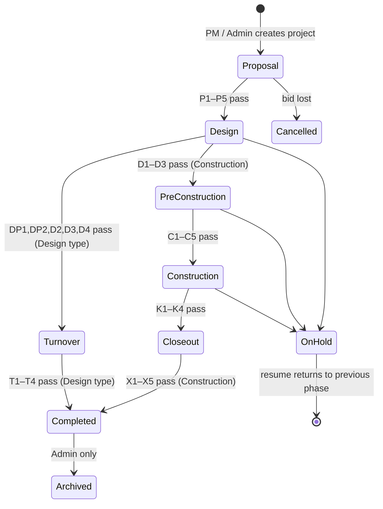

<!-- Copy of project doc claude/easyconstruct-lifecycle-current.md (written Oct 8 2026 against the old staging layout).
     Repo paths have since changed: lifecycle code is now under apps/api/src/modules/projects/lifecycle/.
     Treat this as the reference for QA, and verify against the code. Report drift; do not edit this file to match failing tests. -->

# EasyConstruct — Project Lifecycle (current, refactored)

> **What this is:** the lifecycle as the system works today, replacing the Sept 23 plan (`project-lifecycle-integration.md`), which described it before it was built.
> **Checked against:** repo `nhyl-beta/construction-system-easyconstruct`, branch `staging` @ `d4d8a54` (Oct 8 2026). Read from the code (`server/src/lifecycle/*`, `workflows`, `design-requests`, `payroll`, `scripts/seed-demo-accounts.ts`); the app was not run.
> **Scope:** `Cancelled`, `On Hold`, AI signals and the RFI/RFA module are covered only where they touch the lifecycle.

---

## 1. What changed since the Sept 23 plan

| Area | Sept 23 plan | System now |
|---|---|---|
| Delivery types | One path (construction) | **Two paths.** `Construction` (full) and `Design` (plan sets only: Proposal → Design → **Turnover** → Completed → Archived). Stored on `projects.delivery_type`; the phase after Design is still stored as `Closeout` and labelled "Turnover" |
| Construction progress | `30 + 65 × tasks done / total tasks` | `30 + 65 × done / total`, where the units are **tasks + live milestones** (active, at-risk, completed). Draft and cancelled milestones are not counted. 0 units → 30 |
| Design progress | n/a | Proposal 0–10 (gate share), **Design 10–90 (average of plan-set points)**, Turnover 90–99 (gate share) |
| Closeout gate | X1–X4 | X1–X4 **+ X5 "No open RFI/RFA"** |
| Design gate (construction) | D1–D3 | Unchanged (D1–D3). A Design project uses DP1, DP2, D2, D3, D4 instead |
| Closeout workflow | Engineer → Consultant → Finance → PM → Admin | **Engineer → Finance → PM → Admin** (Consultant stage dropped) |
| New modules in the loop | none | RFI/RFA + transmittals (`design-requests`, `transmittals`), plan sets (`deliverables`), HR→Finance payroll engine with batch review states |
| Overdue handling | none | Hourly in-process job notifies assignee + Admin once per overdue RFI/RFA |
| Notifications | Fix mismatch | Role + user + project addressed via `notifyProject`; SSE to the bell |
| AI | Hidden behind flag | Same flag (`FEATURE_AI` / `VITE_FEATURE_AI`); signals are appended to the lifecycle view only, never to `canAdvance` or checks (`boundary.test.ts` enforces this) |

Everything else in the Sept 23 design (gated Advance, server-owned progress, `project_phase_history`, `assertProjectWritable`, `my-actions`) shipped as specified.

---

## 2. Phase model

Single source: `server/src/lifecycle/phases.ts` (+ `delivery.ts` for the Design path).

| Phase | Construction project | Design project |
|---|---|---|
| Proposal | 0 → 10 (5 checks) | same |
| Design | 10 → 25 | 10 → 90 (plan-set average) |
| Pre-Construction | 25 → 30 | **skipped** |
| Construction | 30 → 95 (tasks + milestones) | **skipped** |
| Closeout / Turnover | 95 → 99 | 90 → 99 (label "Turnover") |
| Completed / Archived | 100 | 100 |
| On Hold / Cancelled | frozen at last value | frozen |

**Rules (as enforced in `lifecycle/service.ts`)**

- Only the lifecycle endpoints change `status` and `progress`; `refreshProjectProgress` is the only writer of `projects.progress`.
- **Advance:** Admin, or the project's own PM (`pm_user_id`, falling back to name match while it is null). A blocked advance returns **409 with the failing checks**. Admin can override with `override: true` and a reason of ≥10 characters; it is stored in `project_phase_history` (`override = true`, gate snapshot) and the audit log.
- **Hold / Resume:** PM of the project or Admin. Hold only from Design, Pre-Construction or Construction, reason required, previous phase saved.
- **Cancel:** PM or Admin from Proposal; **Admin only** after that. Reason required.
- **Archive:** Admin only, only from Completed. `Completed → Archived` is not an Advance step.
- **Write lock:** `assertProjectWritable` rejects project-scoped writes with 409 in `Archived`, `Cancelled`, `On Hold`.
- **Attendance** is accepted only in Construction or Closeout.

---

## 3. Gates (what must be true to leave each phase)

Every check returns `{ key, label, ownerRoles, passed, detail, link }`. `ownerRoles` drives the "Waiting on you" card.

### Proposal (both types) — 2% each

| Key | Check | Owner |
|---|---|---|
| P1 | Architect staffed | PM |
| P2 | Consultant staffed | PM |
| P3 | ≥1 proposal with a linked workflow | Architect |
| P4 | A linked proposal's workflow is `completed` | Consultant, PM |
| P5 | Notice of Award **and** Contract on file, contract value > 0 | PM, Admin |

### Construction path

| Phase | Keys | What they require | Owner |
|---|---|---|---|
| Design | D1 | Design with files assigned to an engineer staffed on the project | Architect, PM |
| | D2 | ≥1 design; all designs `Approved`; no review still `Pending` | Consultant, PM |
| | D3 | Approved, current blueprint for the project | Architect |
| Pre-Construction | C1 | Materials + Specifications requirements approved; none Draft/Under Review | Engineer, PM |
| | C2 | Budget lines exist, all approved, total planned > 0 | Finance |
| | C3 | Milestones dated, none draft, ≥1 active | PM |
| | C4 | Site crew staffed with Active employee records and logins; tasks exist; each active milestone has a linked task for a staffed worker | PM, Engineer, HR, IT Designer |
| | C5 | Notice to Proceed on file + site lat/long set | PM |
| Construction (exit) | K1 | ≥1 task, all Completed | Site Personnel |
| | K2 | All milestones completed or cancelled | PM |
| | K3 | No issues Submitted / Under Review | Engineer, PM |
| | K4 | No active workflows | role of each current stage |
| Closeout | X1 | Final Inspection report `Approved` | Engineer, PM |
| | X2 | Certificate of Completion on file | PM, Admin |
| | X3 | A payroll batch `approved` after Closeout entry, none `pending` | HR, Finance |
| | X4 | "Project Closeout" workflow `completed` | current stage role |
| | **X5** | **No open RFI/RFA** | PM, Admin |

### Design path (replaces D1–D3 / Pre-Construction / Construction / Closeout)

| Phase | Keys | What they require | Owner |
|---|---|---|---|
| Design | DP1 | Plan sets exist and each has a lead | Architect, PM |
| | DP2 | Each plan set has a design with files | Architect |
| | D2, D3 | As above | Consultant/PM, Architect |
| | D4 | No open RFI/RFA | PM, Admin |
| Turnover | T1 | Turnover Document on file | Architect, PM |
| | T2 | Client Acceptance document on file | PM, Admin |
| | T3 | "Design Turnover" workflow `completed` | current stage role |
| | T4 | No open RFI/RFA | PM, Admin |

**Plan-set points** (Design progress): `not_started 0`, `in_progress 40`, `for_review 70`, `approved 90`, `issued 100`. Who can move a plan set: PM/Admin any step; Architect up to `for_review`; Consultant to `approved` or back to `in_progress`.

**An RFI/RFA counts as open** until its status is `answered`, `approved`, `approved_as_noted`, `rejected` or `closed` (so `draft`, `open` and `in_review` all block).

---

## 4. Role interaction by phase (Construction path)

| Role | Proposal | Design | Pre-Construction | Construction | Closeout → Archive |
|---|---|---|---|---|---|
| **PM** | Creates project, staffs Architect + Consultant, approves proposal (last stage), uploads NOA + Contract, advances | Staffs Engineer, decides design reviews, advances; raises RFIs | Approves requirements, activates milestones, creates tasks, uploads NTP + sets geofence, advances | Updates milestones, resolves issues, signs off budget changes, advances | Approves Final Inspection, uploads COC, PM stage of Closeout, advances to Completed |
| **Admin** | Can create projects, override | Override only | Override only | Final stage of budget change / change order | Final stage of Closeout; **archives** |
| **Architect** | Submits proposal | Designs, blueprints, revisions; answers RFIs | — | Responds to RFI/RFA; revisions | As-built drawings |
| **Consultant** | Reviews proposal | Decides design reviews; answers RFIs | — | Advisory documents | — |
| **Engineer** | — | Assigned to designs; raises RFI/RFA | Drafts requirements, creates tasks | Progress reports, issues, **marks milestones completed**, budget change requests | Final Inspection report; starts Project Closeout workflow |
| **Finance** | — | — | Creates + approves budget | Reviews budget changes, payroll batches, expenses | Reconciliation stage (blocked by pending expenses); final payroll |
| **HR** | — | — | Confirms crew records are Active | Verifies attendance, builds and submits payroll batches | Final payroll batch |
| **Site Personnel** | — | — | Can draft requirements | Geofenced attendance (or sheet import), task updates, issues | — |
| **IT Designer** | Accounts | — | Makes sure crew has logins | — | Audit trail (read-only) |
| **Owner** | Portfolio | Portfolio | Portfolio | Portfolio | Notified on Completed; closeout summary |

On a **Design** project the same roles act, but only on Proposal, Design (plan sets, designs, reviews, RFI/RFA) and Turnover (Architect → Consultant → PM → Admin). Site crew, attendance, NTP and Final Inspection do not apply.

---

## 5. Cross-module interactions that feed the lifecycle

**Workflow templates** (stage order, each stage owned by one role)

| Template | Stages | Lifecycle link |
|---|---|---|
| Design Proposal Approval | Architect → Consultant → PM | P3, P4; workflow decides, proposal status follows |
| Budget Change Request | Engineer → Finance → PM → Admin | Final approval writes `budget_adjustments` and updates `budgets.planned`; open workflow blocks K4 |
| Change Order Request | PM → Engineer → Finance → Admin | Can be started from an RFI/RFA with cost or time impact; blocks K4 while active |
| Project Closeout | Engineer → Finance → PM → Admin | X4; startable only by Engineer/Admin and only in Closeout; one at a time |
| Design Turnover | Architect → Consultant → PM → Admin | T3; Design projects only, startable at Turnover |
| Public works compliance, Document Compliance Review, Subcontractor onboarding | as seeded | Count toward K4 while active |

**RFI/RFA** — PM or Engineer raises; Architect or Consultant answers. Numbered `{KIND}-{PROJECT}-{DISC}-{SEQ:3}-{YY}`; default due 3 days (RFI) / 4 days (RFA); overdue is derived, never stored. An Engineer's draft needs PM "send" (the countersign). Gates X5 / D4 / T4 read open requests.

**Payroll** — Site attendance (geofence, or sheet import as *Pending*) → HR verifies → HR builds a batch (`draft`) → submits (`pending`) → Finance approves (`approved`) or returns it (`revision_required`) → HR resubmits. Statutory amounts are computed by the engine from effective-dated rate versions, never typed. Approval adds to the project's Labor budget and refreshes progress.

**Progress refresh** — called after writes in: attendance, blueprints, design-requests, designs (+ reviews, revisions), documents, engineering-reports, finance budget and expenses, issues, milestones, payroll, project-members, projects, proposals, requirements, revisions, tasks, transmittals, workflows, deliverables.

**Notifications** — phase changes go to all project members + PM; Owner on Completed; entering a phase notifies each role that owns one of its checks; workflow stage changes, task/issue/design-review/requirement/payroll events, and RFI/RFA create/respond/overdue also notify. In-app only (SSE); email is used for password reset and Owner recovery.

---

## 6. Drift and open items found in the code

1. **X3 ignores `revision_required`.** It fails only on `pending` batches. A payroll batch Finance has sent back (`revision_required`) or one still `draft` does not block Closeout as long as one batch was approved after entry. Decide whether any non-approved, non-rejected batch should block, then update `x3` and its test.
2. **Dead naming.** Docs and prompts still say Closeout includes the Consultant; the seeded template does not. The Sept 23 doc and `lifecycle-build-prompt.md` should be marked superseded.
3. **Construction progress counts milestones.** The manuscript's "progress by task" wording and the D-2 comment in `phases.ts` ("derives from completed/total tasks") are stale.
4. **Design projects hide Pre-Construction/Construction** in the phase path, but their progress band for Design (10–90) differs from the Construction band (10–25). Any chart or report that assumes fixed bands per phase must read `view.band` rather than `PHASE_BANDS`.
5. **Completed → Archived is not Advance.** The view reports `Completed has no Advance step` as the blocked reason; the UI should show the Archive action instead of a disabled Advance.
6. **Lifecycle now spans staging vs prod.** The staging deployment currently shares the production Neon branch (decision in progress), so demo-project Advance/Cancel actions on staging affect real data. Treat `DEMO-STAGE-*` projects as the only safe ones to move.

---

## 7. Demo path (what to show)

`DEMO-STAGE-0` … `DEMO-STAGE-6` cover one project per phase (Proposal 8%, Design 25%, Pre-Construction 29%, Construction 59%, Closeout 99%, Completed 100%, Archived 100%). Link by code (`/projects/DEMO-STAGE-3`). To demonstrate the refactor specifically:

1. Open a Construction project → lifecycle panel → show checks, owner roles, blocked Advance (409).
2. Raise an RFI from the PM → project shows X5 failing → Architect answers → X5 passes.
3. Open a Design project → plan sets → move one set to `for_review` → progress shifts within 10–90.
4. Closeout → show X3 using a `revision_required` batch (item 6.1 above) before deciding the fix.

---

*Related project docs: `project-lifecycle-integration.md` (original plan, superseded by this file), `lifecycle-build-prompt.md`, `rfi-rfa-design-type-build-prompt.md`, `payroll-and-attendance-sheet-revision-prompt.md`, `system-vs-scope-interview-gaps.md`.*
